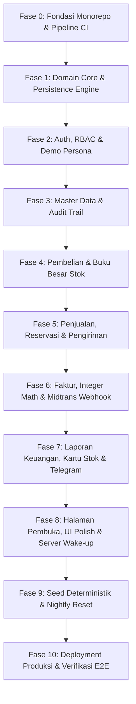

# Panduan Implementasi Bertahap — Lumbung Mini ERP

Dokumen ini adalah rencana teknis pelaksanaan proyek **Lumbung** dari awal
(_greenfield_) hingga rilis produksi di server gratis (Neon, Render, Cloudflare
Pages). Disusun dengan mematuhi prinsip **Clean Architecture**, **Domain-Driven
Design (DDD) taktis**, dan **Clean Code**, serta bebas dari abstraksi kosong
(_anti-AI slop_).

---

## 1. Prinsip Arsitektur & Aturan Kode (_Non-Negotiables_)

### 1.1 Aturan Ketergantungan (_Clean Architecture_)

```
┌────────────────────────────────────────────────────────┐
│  Presentation / Driving Adapters                       │
│  (FastAPI Routers, CLI scripts, Background Jobs)       │
│  └─► Application Layer / Use Cases                    │
│      (Services, Unit of Work, Orchestration)           │
│      └─► Domain Layer (Inti Bisnis Murni)              │
│          (Entities, Value Objects, State Machines)     │
│  ┌─► Infrastructure / Driven Adapters                  │
│  (SQLAlchemy 2.0, Postgres Locks, Midtrans, Resend)   │
└────────────────────────────────────────────────────────┘
```

1. **Domain Layer (`backend/app/domain/`) murni Python:**
   - **Dilarang mengimpor:** `fastapi`, `sqlalchemy`, `pydantic` (hanya
     `dataclasses`/typing murni), `requests`/`httpx`, atau pustaka I/O apa pun.
   - Semua kalkulasi uang menggunakan integer rupiah (representasi `int` atau
     Value Object `Money`).
   - Semua validasi transisi status adalah mesin status murni (`Enum` dan metode
     transisi terisolasi).
   - Kesalahan domain dilempar sebagai custom exception murni (mis.
     `StockInsufficientError`, `InvalidStateTransitionError`,
     `DocumentLockedError`).
2. **Application Layer (`backend/app/services/`):**
   - Mengorkestrasi interaksi antara repositori, domain logic, dan port
     eksternal.
   - Menangani batas transaksi (_database transaction boundaries_) dan
     idempotensi.
   - Tidak membocorkan ORM model ke API layer; mentransformasi DTO/Pydantic
     schemas.
3. **Infrastructure Layer (`backend/app/models/`,
   `backend/app/integrations/`):**
   - Berisi implementasi database SQLAlchemy 2.0 (declarative), migrasi Alembic,
     raw constraints SQL.
   - Menyediakan implementasi _Driven Ports_ (`PaymentGateway`, `Mailer`,
     `Notifier`) dengan implementasi ganda: **Real Adapter** dan
     **Fake/In-Memory Adapter** untuk tes dan dev lokal tanpa internet.
4. **Presentation Layer (`backend/app/api/`):**
   - Menangani HTTP request/response, otentikasi JWT, validasi skema Pydantic
     v2, dan pemetaan error domain ke format response RFC-7807/standar Lumbung
     (PRD bag. 12).
5. **Frontend Architecture (`frontend/src/`):**
   - Tipe data bersumber dari OpenAPI spec via `openapi-typescript` (bukan
     mengetik ulang tipe manual).
   - Logika bisnis (hitung diskon, stok, total) tidak diduplikasi di frontend;
     UI hanya menampilkan hasil server atau preview berlabel jelas.
   - Desain terikat kaku pada token CSS `design.md` (tidak ada arbitrary inline
     hex).

---

## 2. Peta Tahapan Implementasi (M0 — M7)



---

## Fase 0: Fondasi Monorepo, Tooling & CI Dasar (M0)

**Tujuan:** Memastikan struktur kode bersih, linter, type-checker, dan CI GitHub
Actions berjalan hijau sebelum satu baris pun logika bisnis ditulis.

### Langkah Kerja:

1. **Inisialisasi Monorepo:**
   ```
   lumbung/
   ├── backend/
   │   ├── app/
   │   │   ├── api/
   │   │   ├── core/
   │   │   ├── domain/
   │   │   ├── integrations/
   │   │   ├── models/
   │   │   └── services/
   │   ├── migrations/
   │   ├── tests/
   │   └── pyproject.toml
   ├── frontend/
   │   ├── src/
   │   ├── tests/
   │   └── package.json
   ├── docs/
   └── .github/workflows/
   ```
2. **Setup Backend Tooling:**
   - Gunakan Python 3.12, manajemen dependensi modern (`uv` atau
     `poetry`/`pip-tools`).
   - Linter & Formatter: `ruff` (linter + formatter tercepat dan ketat).
   - Type Checker: `mypy --strict` atau `pyright`.
   - Test Runner: `pytest` + `pytest-asyncio` + `hypothesis`.
3. **Setup Frontend Tooling:**
   - Vite + React 19 + TypeScript (strict mode `tsconfig.json`).
   - Linter & Formatter: `eslint` (flat config) + `prettier`.
   - CSS setup: konfigurasi variabel CSS sesuai `design.md` bagian 14.
4. **CI Pipeline (`.github/workflows/ci.yml`):**
   - Job Backend: checkout, setup Python, `ruff check`, `mypy`, `pytest` (dengan
     postgres service container di CI).
   - Job Frontend: checkout, setup Node.js, `npm run lint`, `npm run typecheck`,
     `npm run build`.

---

## Fase 1: Domain Core & Database Engine (M0 — M1 Backend)

**Tujuan:** Membangun fondasi aturan bisnis murni yang tidak bisa dirusak oleh
bug aplikasi.

### Langkah Kerja:

1. **Domain Value Objects (`backend/app/domain/values.py`):**
   - `Money`: representasi bilangan bulat rupiah (`int`). Metode tambah, kurang,
     alokasi proporsional (menggunakan algoritma sisa pembagian bulat, bukan
     float).
   - `BasisPoints`: kalkulasi persentase aman (1100 bp = 11% PPN, dsb).
   - `DocNumber`: format `{JENIS}-{TAHUN}-{URUT:06d}`.
2. **Domain Status State Machines (`backend/app/domain/state_machine.py`):**
   - Validasi eksplisit transisi status SO
     (`draf -> dikonfirmasi -> sebagian_terkirim -> terkirim -> selesai` atau
     `batal`).
   - Validasi status PO, INV, DO. Setiap transisi mengembalikan objek event
     untuk audit log.
3. **Engine Basis Data & SQLAlchemy Models (`backend/app/models/`):**
   - Setup async/sync engine SQLAlchemy 2.0 (menghindari session sharing bugs).
   - Tabel `doc_sequences`: penguncian baris (`SELECT ... FOR UPDATE`) per
     `(doc_type, year)`.
   - Tabel `stock_moves` (append-only) dan `stock_balances`.
   - Tabel `audit_log` dan `companies`.
4. **Hard Constraints di PostgreSQL (`migrations/`):**
   - Skrip migrasi Alembic awal dengan SQL DDL constraints:
     - `CHECK (on_hand >= 0)`
     - `CHECK (reserved >= 0)`
     - `CHECK (reserved <= on_hand)`
     - `CREATE RULE no_update_stock_moves AS ON UPDATE TO stock_moves DO INSTEAD NOTHING;`
     - `CREATE RULE no_delete_stock_moves AS ON DELETE TO stock_moves DO INSTEAD NOTHING;`
5. **Endpoint Dasar:**
   - `GET /health` (memeriksa konektivitas DB dan waktu latensi).

---

## Fase 2: Autentikasi, RBAC & Demo Persona (M1)

**Tujuan:** Otentikasi aman tanpa kebocoran hak akses, plus mekanisme
instant-login demo persona untuk rekruter.

### Langkah Kerja:

1. **Password Hashing & Token Management (`backend/app/core/security.py`):**
   - Password hashing menggunakan `argon2id` (`pwdlib` atau `passlib[argon2]`).
   - Akses token JWT (ed25519 atau HS256) berumur 15 menit.
   - Refresh token berumur 14 hari, disimpan dalam tabel `refresh_tokens` dalam
     bentuk hash SHA-256 dan dikirim via cookie `httpOnly`, `Secure`,
     `SameSite=Lax`.
2. **Matriks Hak Akses / Permissions Matrix
   (`backend/app/core/permissions.py`):**
   - Definisikan tipe `Permission(str, Enum)` dan pemetaan per peran (`Admin`,
     `Sales`, `Warehouse`, `Finance`) merujuk pada PRD tabel 8.3.
   - FastAPI dependency `require_permission(perm: Permission)`.
3. **Akun & Endpoint Demo:**
   - `POST /api/v1/auth/demo/{role}`: langsung menerbitkan cookie refresh token
     dan access token untuk peran demo tanpa meminta password.
   - Batasi rate-limiting untuk endpoint auth (menggunakan token-bucket
     in-memory / redis-free rate limiter).
4. **Google OAuth 2.0 (PKCE):**
   - Endpoint `GET /auth/google/login` & `GET /auth/google/callback`.
   - Pengguna Google baru masuk dengan status hanya-baca jika di luar mode demo.
5. **Pengujian Izin Komprehensif (`tests/test_permissions.py`):**
   - Tes matriks terparameter: uji setiap endpoint terhadap keempat peran.
     Verifikasi 403 Forbidden ketika peran tidak berhak.

---

## Fase 3: Master Data & Audit Trail Engine (M2)

**Tujuan:** Pengelolaan entitas master (Produk, Kategori, Pelanggan, Pemasok)
dengan jejak audit otomatis pada setiap perubahan.

### Langkah Kerja:

1. **Domain & Repositori Master Data:**
   - Produk: SKU unik (regex validasi), nama, satuan (pcs, sak, kg), harga jual
     (`int`), harga beli terakhir (`int`), stok minimum.
   - Pelanggan & Pemasok: kode unik, termin pembayaran (`terms_days`), batas
     kredit (`credit_limit`).
   - Aturan _soft-deactivation_: produk yang sudah pernah ada di transaksi tidak
     boleh dihapus hard-delete (`is_active = False`).
2. **Interceptor Jejak Audit (`AuditService`):**
   - Transaksi database mencatat perubahan ke tabel `audit_log` (`actor_id`,
     `entity`, `entity_id`, `action`, `diff`).
3. **Impor CSV Produk (`POST /api/v1/products/import`):**
   - Mode dua tahap: Tahap validasi (dry-run menghasilkan daftar baris valid &
     daftar error) -> Tahap komit.
4. **UI Master Data:**
   - Tabel TanStack Table dengan server-side sorting, filtering, dan kursor
     pagination.
   - Kolom angka rata kanan dengan font monospaced (`IBM Plex Mono`), mata uang
     berformat konsisten.

---

## Fase 4: Pembelian & Buku Besar Stok Bersamaan (M3)

**Tujuan:** Memastikan stok tidak pernah meleset atau minus walau 50 request
datang bersamaan.

### Langkah Kerja:

1. **Purchase Order (PO) & Goods Receipt (GR):**
   - Transisi PO: `draf -> dipesan -> sebagian_diterima -> diterima`.
   - Penerimaan barang (`GoodsReceipt`) memvalidasi bahwa kuantitas yang
     diterima tidak melebihi pesanan.
2. **Domain Buku Besar Stok (`StockLedger`):**
   - Penulisan ke `stock_moves` (selalu append baris baru).
   - Pembaruan saldo `stock_balances`:
     - Kueri `SELECT * FROM stock_balances WHERE product_id = :id FOR UPDATE;`
     - Urutkan `product_id` secara konsisten sebelum `SELECT FOR UPDATE` untuk
       mencegah _deadlock_.
     - Rekalkulasi metode rata-rata bergerak (_moving average cost_):
       $$\text{cost}_{\text{baru}} = \left\lfloor \frac{(\text{qty}_{\text{lama}} \times \text{cost}_{\text{lama}}) + (\text{qty}_{\text{masuk}} \times \text{cost}_{\text{masuk}})}{\text{qty}_{\text{lama}} + \text{qty}_{\text{masuk}}} \right\rfloor$$
3. **Penyesuaian Stok (Stock Adjustment):**
   - Endpoint khusus `POST /api/v1/stock/adjustments` dengan kolom wajib:
     `reason` (rusak, hilang, opname, koreksi) dan `notes`.
4. **Pemeriksa Konsistensi Stok (_Stock Consistency Checker_):**
   - Service background / internal job: memvalidasi bahwa
     `stock_balances.on_hand == SUM(stock_moves.qty)`.
5. **Uji Konkurensi & Properti Stok (`tests/test_stock_concurrency.py`):**
   - Tes Hypothesis: properti invarian stok tidak pernah melanggar saldo.
   - Tes paralel 50 worker: menembakkan serentak pengurangan stok melebihi
     batas. Verifikasi PostgreSQL menolak transaksi berlebih tanpa deadlocks
     atau saldo minus.

---

## Fase 5: Penjualan, Reservasi Stok & Pengiriman (M4)

**Tujuan:** Alur penjualan lengkap dengan reservasi stok otomatis saat
konfirmasi dan penguncian harga.

### Langkah Kerja:

1. **Sales Order (SO) Domain Engine:**
   - Pembuatan Draf: bebas edit baris, harga, dan diskon.
   - Aksi Konfirmasi (`POST /api/v1/sales-orders/{id}/confirm`):
     - Kunci urutan nomor dokumen unik (`doc_sequences`).
     - Kunci baris saldo stok produk (`SELECT ... FOR UPDATE`).
     - Validasi: `tersedia = on_hand - reserved >= diminta`.
     - Naikkan `reserved += diminta`.
     - Kunci harga (`is_locked = True`).
   - Pembatalan SO: kembalikan `reserved -= diminta` (hanya boleh jika belum ada
     pengiriman).
2. **Delivery Order (DO) / Surat Jalan:**
   - Pengiriman barang parsial atau penuh.
   - Eksekusi pengiriman:
     - Mengurangi `on_hand` dan `reserved` secara bersamaan:
       `on_hand -= qty_kirim`, `reserved -= qty_kirim`.
     - Menulis mutasi keluar di `stock_moves` jenis `pengiriman`.
     - Mengambil snapshot HPP (_Cost of Goods Sold_) dari
       `stock_balances.avg_cost` saat itu.
3. **UI Dokumen & Stepper:**
   - Komponen Kepala Dokumen sesuai `design.md` bagian 6.3.
   - Stepper status visual non-dekoratif (Draf -> Dikonfirmasi -> Terkirim ->
     Selesai).
   - Tabel baris dengan navigasi keyboard (`Tab`, `Enter`, `Ctrl+Backspace`).

---

## Fase 6: Faktur, Matematika Integer & Webhook Midtrans (M5)

**Tujuan:** Pembuatan faktur dari DO yang valid, perhitungan uang tanpa galat
pembulatan, dan webhook pembayaran yang aman/idempoten.

### Langkah Kerja:

1. **Domain Faktur (Invoicing):**
   - Faktur ditarik hanya dari baris `DeliveryOrder` yang belum difakturkan
     (`uq_invoice_line_delivery_line` mencegah duplikasi).
   - Harga baris diambil dari SO awal.
   - Perhitungan total berbasis integer rupiah:
     - Diskon baris: dibulatkan setengah naik.
     - PPN: `(subtotal_setelah_diskon * 1100 + 5000) // 10000` (pembulatan
       integer).
     - Total = Subtotal + PPN.
2. **Generator PDF Faktur (`backend/app/services/invoice_pdf.py`):**
   - Menggunakan Python murni (`fpdf2` atau `reportlab`).
   - Layout formal dokumen dagang sesuai standar visual Lumbung.
3. **Integrasi Pembayaran Midtrans (Sandbox) & Idempotensi:**
   - Port `PaymentGateway` dengan implementasi `MidtransGateway` dan
     `FakePaymentGateway`.
   - Endpoint Webhook `POST /api/v1/webhooks/midtrans`:
     - Verifikasi Signature SHA-512
       (`order_id + status_code + gross_amount + server_key`). Gunakan
       `hmac.compare_digest` untuk proteksi _timing attacks_.
     - Catat notifikasi mentah di tabel `webhook_events`
       (`provider, event_key`). Tolak event duplikat.
     - Verifikasi silang balik ke API status Midtrans sebelum menandai faktur.
     - Status faktur dihitung ulang secara deterministik dari jumlah record di
       tabel `payments`.
4. **Halaman Publik Bayar (`/bayar/{token}`):**
   - Akses aman tanpa autentikasi pengguna ERP. Token unik dengan masa
     kedaluwarsa.
   - Menampilkan ringkasan faktur dan tombol Midtrans Snap.

---

## Fase 7: Laporan Keuangan, Kartu Stok & Notifikasi Telegram (M6)

**Tujuan:** Dashboard operasional berbasis data nyata, ekspor akurat, dan
notifikasi ke bot Telegram.

### Langkah Kerja:

1. **Laporan Operasional:**
   - **Kartu Stok:** Rekap kronologis mutasi keluar-masuk per produk dengan
     saldo berjalan.
   - **Nilai Persediaan:** $\sum (\text{on\_hand} \times \text{avg\_cost})$ per
     produk dan total.
   - **Umur Piutang (AR Aging):** Klasifikasi faktur belum lunas ke dalam
     bucket: _Belum Jatuh Tempo_, _1–30 Hari_, _31–60 Hari_, _>60 Hari_.
   - **Laporan Penjualan:** Omzet dan margin kotor (Penjualan - HPP).
2. **Ekspor CSV:**
   - Generator CSV streaming dengan header MIME standar untuk setiap tabel
     laporan.
3. **Integrasi Telegram Bot:**
   - Port `Notifier` dengan adapter `TelegramNotifier` (asinkron via `httpx`
     tanpa memblokir request utama).
   - Format pesan ringkas: Nomor Dokumen, Nominal, Pelaku, dan tautan langsung
     ke dokumen.
   - Notifikasi dipicu pada: SO dikonfirmasi, Stok di bawah minimum, Pembayaran
     diterima, Faktur jatuh tempo.

---

## Fase 8: Portfolio Shell, Landing Page & Penanganan Cold-Start (M1 / M7)

**Tujuan:** Memberikan impresi terbaik kepada rekruter teknis bahkan ketika
backend gratis sedang tidur.

### Langkah Kerja:

1. **Layar "Server Sedang Bangun" (Cold-Start Screen):**
   - Implementasi pada interceptor HTTP / TanStack Query client di frontend:
     - Jika request awal memakan waktu > 3 detik, transisikan UI ke layar ramah:
       "Server demo gratis sedang bangun (biasanya ~60 detik)".
     - Tampilkan stopwatch waktu berlalu dan link statis (Arsitektur, ERD, Repo
       GitHub) agar waktu tunggu bernilai bacaan teknis.
     - Saat request kembali 200, tutup layar otomatis tanpa refresh halaman.
2. **Landing Page Portofolio (`/`):**
   - Sesuai `design.md` bagian 10: Tenang, tipografi serif (`Newsreader`), tanpa
     gambar generik/hero stock photos.
   - **Diagram Alur Interaktif:** SVG dinamis dari dokumen dagang PO -> GR ->
     STOK -> SO -> DO -> INV -> PAY.
   - **Empat Tombol Demo Cepat:** Masuk langsung sebagai Admin, Penjualan,
     Gudang, atau Keuangan.
   - Kirim _silent ping_ `GET /health` di background begitu landing page dibuka
     untuk memicu bangunnya backend Render sebelum pengguna mengklik tombol.
3. **Pintasan Keyboard & Command Palette (Ctrl+K):**
   - Dialog pencarian instan lintas dokumen, produk, dan navigasi cepat.

---

## Fase 9: Seed Deterministik & Nightly Data Reset (M7)

**Tujuan:** Data demo yang realistis dan pembersihan otomatis agar database
gratis 0.5 GB tidak penuh atau dirusak.

### Langkah Kerja:

1. **Deterministic Seed Generator (`seed/seed.py`):**
   - Domain: Distributor Bahan Bangunan "UD Sumber Makmur Jaya".
   - Menggunakan benih acak tetap (`random.seed(42)`).
   - Menghasilkan riwayat 90 hari: ~50 produk dengan SKU terstandar, 20
     pelanggan, 10 pemasok, puluhan transaksi selesai, beberapa faktur jatuh
     tempo, dan 1 penyesuaian stok rusak.
2. **Nightly Reset Engine:**
   - Endpoint internal `POST /api/v1/internal/jobs/reset-demo` dilindungi header
     `X-Internal-Secret`.
   - Mengosongkan tabel transaksi dan menginjeksi ulang seed deterministik dalam
     satu transaksi DB.
3. **GitHub Actions Scheduled Cron:**
   - Workflow GitHub Actions dijalankan setiap malam pukul 00:00 UTC untuk
     memanggil reset.
   - Workflow keepalive ringan setiap 10 menit pada jam kerja.

---

## Fase 10: Deployment Produksi & Verifikasi Akhir (Deployment)

**Tujuan:** Live di internet dengan keandalan maksimal di atas batasan gratis.

### Langkah Kerja:

1. **Setup Neon PostgreSQL:**
   - Buat database instance di Neon (region Frankfurt atau Singapura untuk
     latensi rendah).
   - Terapkan migrasi Alembic: `alembic upgrade head`.
   - Jalankan `python -m seed.seed`.
2. **Setup Render Web Service:**
   - Konfigurasi Web Service Python di Render:
     - Build Command: `pip install -e .`
     - Start Command:
       `uvicorn app.main:app --host 0.0.0.0 --port $PORT --workers 1` (1 worker
       hemat memory untuk tier gratis 512MB RAM).
   - Masukkan Environment Variables rahasia (`DATABASE_URL`, `JWT_SECRET`,
     `MIDTRANS_SERVER_KEY`, dll.).
3. **Setup Cloudflare Pages:**
   - Hubungkan repositori ke Cloudflare Pages.
   - Build Command: `npm run build`
   - Output Directory: `dist`
   - Set variabel `VITE_API_BASE_URL`.
4. **Verifikasi E2E & Audit Kualitas:**
   - Jalankan uji Playwright end-to-end terhadap domain produksi.
   - Audit Google Lighthouse pada landing page: target Performance >= 90,
     Accessibility >= 95.
   - Uji verifikasi kontras WCAG AA di seluruh komponen UI.

---

## Ringkasan Matriks Definisi Selesai (_Definition of Done_)

| Komponen                  | Standar Lolos (_Acceptance Criteria_)                                                      |
| ------------------------- | ------------------------------------------------------------------------------------------ |
| **Kalkulasi Uang**        | 100% integer rupiah (`BIGINT`), tes properti Hypothesis membuktikan zero-drift rounding    |
| **Buku Besar Stok**       | Append-only (dilindungi trigger/rule DB), uji 50 concurrent request bebas race conditions  |
| **Audit Log**             | Semua mutasi status dokumen dan master data terekam lengkap (aktor, waktu, diff)           |
| **Keamanan Webhook**      | Verifikasi HMAC SHA-512 constant-time comparison, mutasi idempoten                         |
| **Tampilan UI**           | Menggunakan token CSS `design.md`, tabular-nums pada angka, bebas gradien ungu/kartun SaaS |
| **Pengalaman Pengunjung** | Cold-start Render tertangani anggun, 1-click login demo, landing page tanpa lag            |
